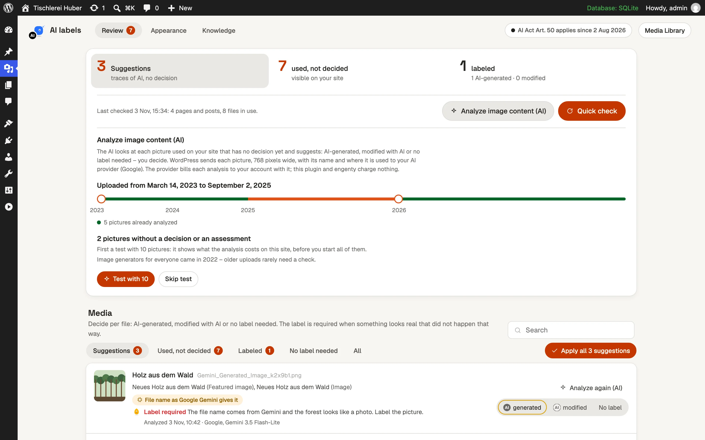
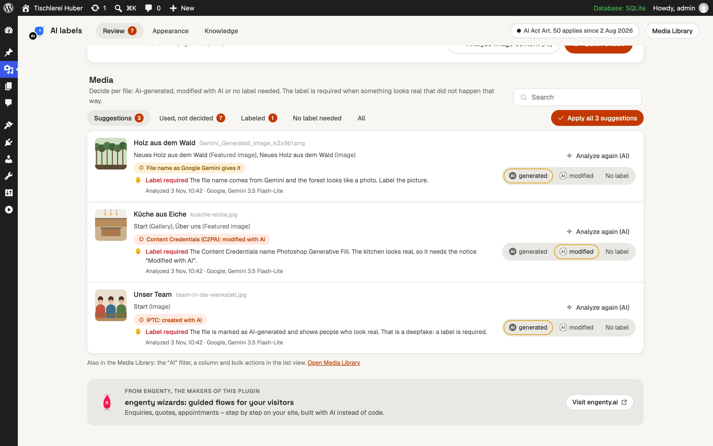
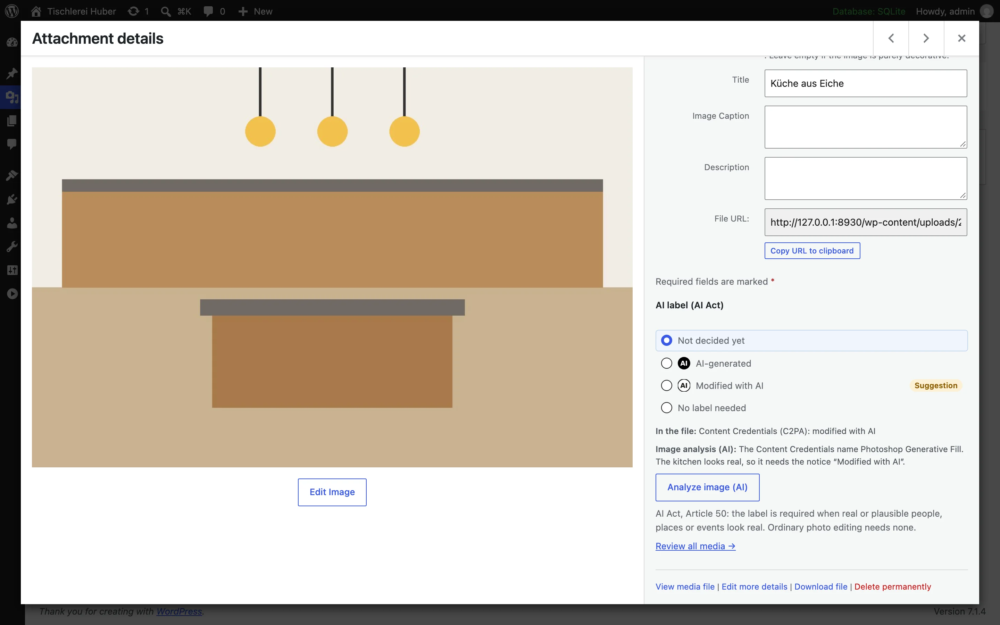
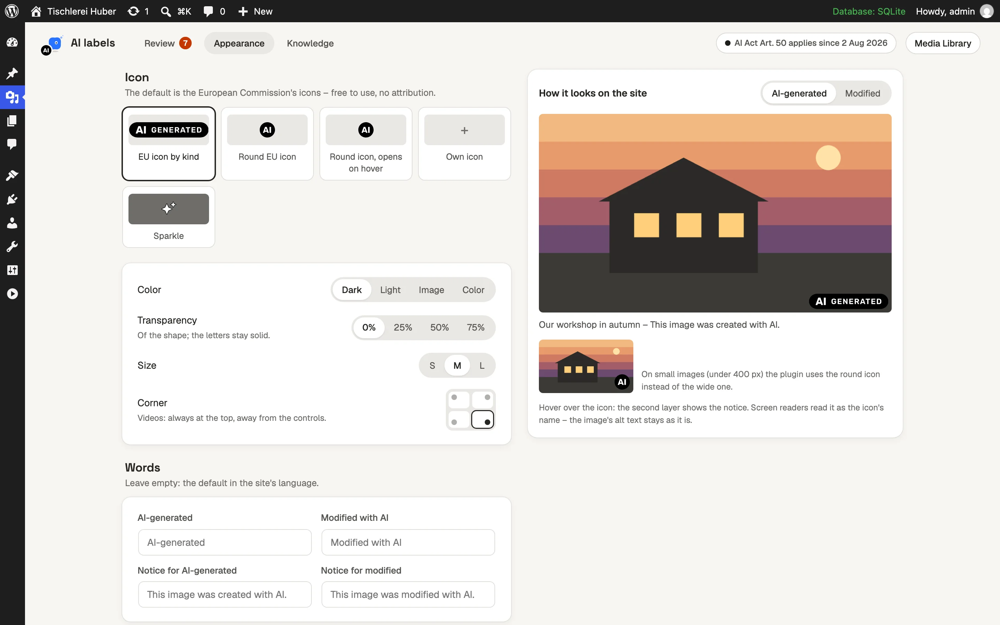
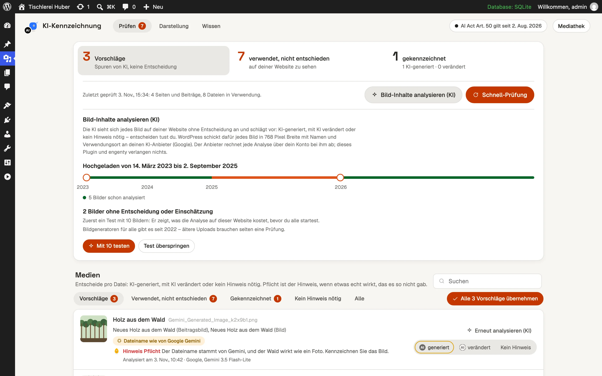
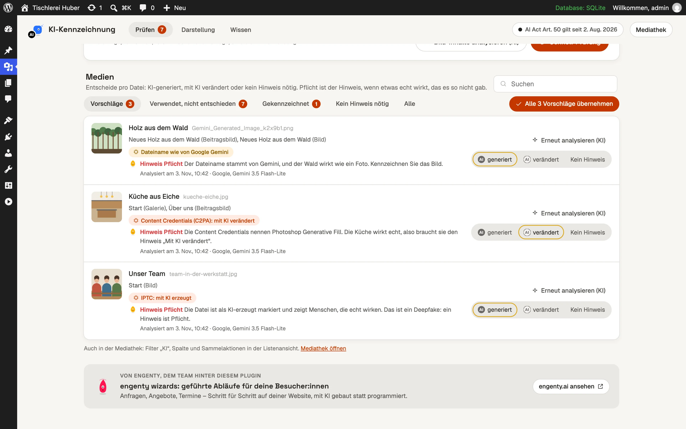
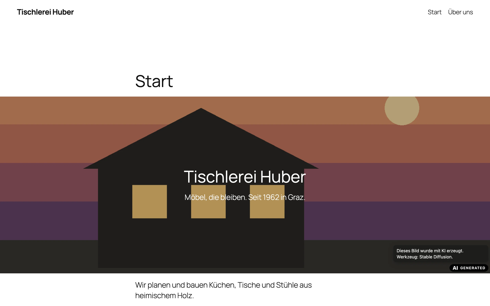
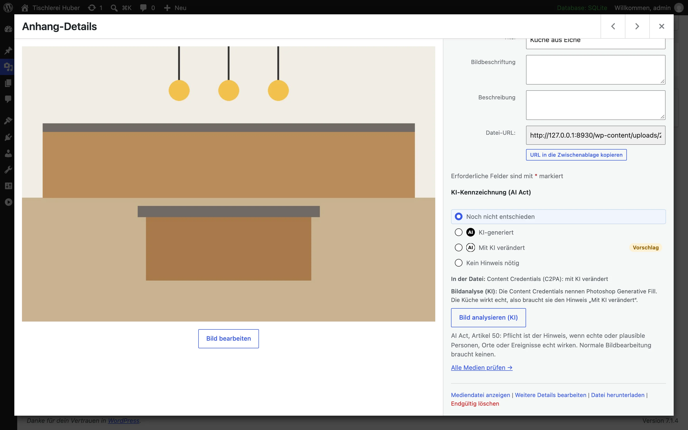

# AI Act Image Labels

**Labels AI-made images, videos and audio that look real on your WordPress site, as the EU AI Act has required of businesses since 2 August 2026.**

1. Download [ai-act-image-labels.zip](https://github.com/matthias/engenty-wp-ai-act-labels/releases/latest/download/ai-act-image-labels.zip).
2. In WordPress: *Plugins › Add New › Upload Plugin*, then activate it.
3. Open *Media › AI labels* and click *Quick check*.

Needs WordPress 6.6+ and PHP 8.1+. Most themes need no changes.

## What it does

- **Finds AI images:** reads traces in your files (C2PA, IPTC, Stable Diffusion data, file names of AI tools) and shows where each file is used.
- **Lets you decide:** *generated*, *modified* or *No label*, per file, in bulk or in the media library.
- **Shows the label:** the European Commission's icon on the image, with the notice on hover and for screen readers. Never in the alt text.
- **Optional AI analysis:** looks at each picture and suggests whether a label is required. Test with 10 pictures to see the cost first.
- **Fits your site:** icon, colour, size, corner and words; 13 languages.

| | |
| --- | --- |
|  |  |
|  |  |

Screenshots in German

## Good to know

- **Theme:** images printed through WordPress, blocks and galleries get the label by themselves. Only a raw `` or a CSS background needs a [theme helper](docs/developers.md#for-themes); *Check on the site* shows the pages where the label is missing.
- **AI provider:** only the analysis needs one: WordPress 7.0+ and a provider under *Settings › Connectors*. The provider bills you; the plugin is free.
- **Privacy:** everything runs on your server. Only when you start an analysis, each picture (768 px wide), its name, traces and page titles go to your AI provider.
- **Not every AI image needs a label:** illustrations nobody takes for a photo and ordinary editing do not. The *Knowledge* tab explains the rules. This plugin is not legal advice.

[For developers](docs/developers.md) · GPL-2.0-or-later
