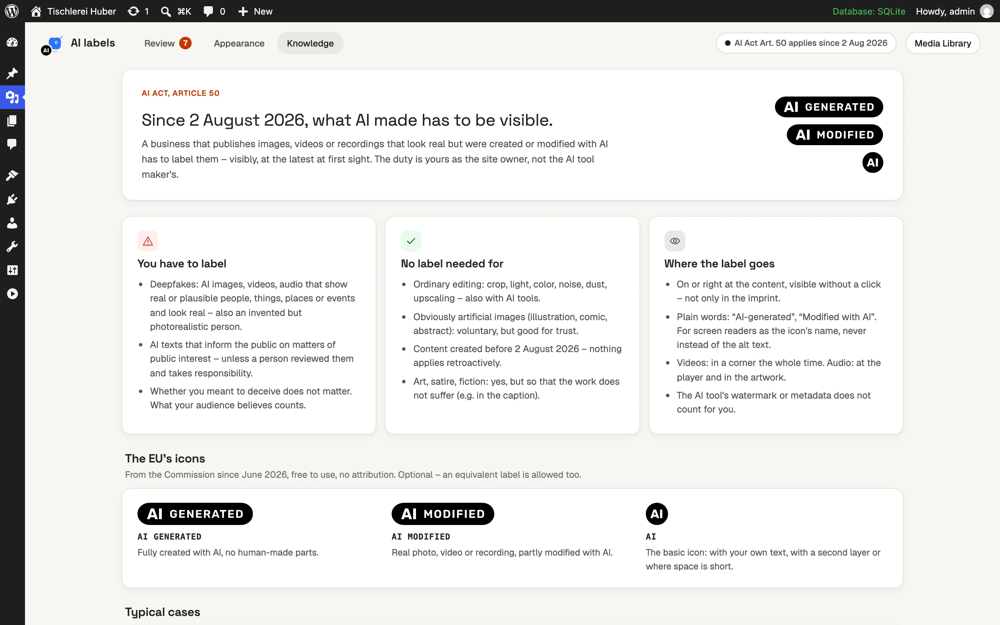
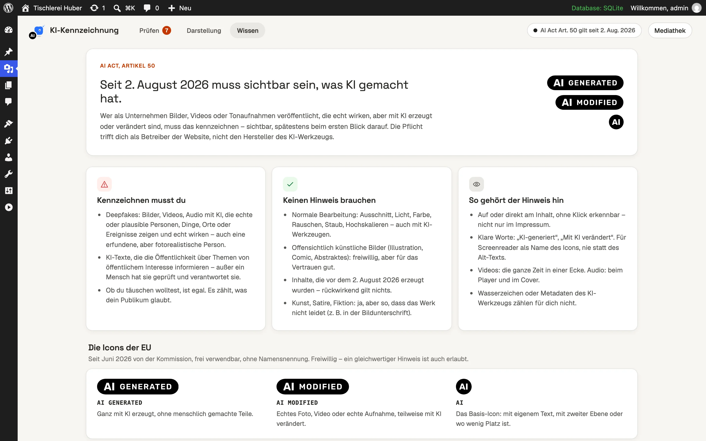

# AI Act Image Labels

A WordPress plugin that marks AI-generated and AI-modified images, videos and recordings the way the EU AI
Act asks, with the European Commission's official icons on your site. You decide per file in the media
library; the plugin finds traces of AI in your files, shows where each file is used and puts the label there.


## Who needs it

Since **2 August 2026**, Article 50 of the EU AI Act asks anyone who publishes content in the EU to label
images, videos and audio that look real but were made or changed with AI (deepfakes: photorealistic people,
products, places or events). The duty lies with the website's operator, not with the AI tool. Illustrations
nobody takes for a photo and ordinary editing (crop, colour, light, noise, upscaling) need no label.

If your site uses AI images – from Midjourney, ChatGPT, Gemini, Firefly, Stable Diffusion or Photoshop's
Generative Fill – this plugin helps you find them, decide, and show the label.

## What it does

### Review: what needs a decision

The tool lives under **Media › AI labels** (German: *Medien › KI-Kennzeichnung*). *Quick check* reads every
page, post, template and reusable block and every file in use. The numbers on top open their lists:

- **Suggestions** – files with traces of AI and no decision yet.
- **Used, not decided** – files visible on your site that nobody has decided on.
- **Labeled** – files that carry the label.

For each file you see where it is used, the traces found in it, and three buttons: *generated*, *modified*,
*No label*. *Apply all suggestions* takes the plugin's suggestions in one click.


### Traces of AI in your files

On upload and on every check the plugin reads the file's own data – C2PA Content Credentials, the IPTC
digital source type, Stable Diffusion and ComfyUI generation data, EXIF tools, the file names AI tools give
their downloads – and suggests a label. This happens on your server; nothing is sent anywhere. A missing trace
proves nothing (screenshots, exports and image optimizers remove them), so you decide; the plugin suggests.

### Analyze image content (AI)

For pictures without traces, the AI looks at the picture itself, its traces and the pages it is on, and says
whether a label is **required**, **voluntary** or **not needed**, with a reason in one or two sentences.
Each analysed file shows when it was analysed and with which model.

- **Per file:** *Analyze image (AI)* in the list and in the media library.
- **For the whole site:** *Analyze image content (AI)* opens a panel. Pick the upload days with the two-handle
  slider (image generators came in 2022 – older uploads rarely need a check), run **Test with 10** first and
  see what the analysis costs on your site, then analyse the rest. The run goes on with WP-Cron when you close
  the page, shows in every window and can be stopped from any of them.

The analysis only suggests. A label appears on your site when you (or *Apply all suggestions*) decide.

### In the media library

Every file's details (modal and edit screen) carry the decision, the traces found in the file and the
analysis. The list view has an *AI* filter, a column and bulk actions; labelled tiles carry the round EU icon.


### On your site

The EU icon (*AI GENERATED*, *AI MODIFIED* or the round *AI*) sits in a corner of the image or video. The
notice ("This image was created with AI.") is the icon's accessible name and appears on hover; it is added
behind captions that are shown anyway – never in the alt text.

Labelled media in the following places get the label by themselves: featured images, image blocks,
galleries, covers, media & text, `[caption]`, video and audio. Images in HTML blocks and page builders are
found by their file. *Check on the site* opens the pages where a labelled file is used and reports whether the
label really appears on each.


### Appearance

Choose the icon (EU icon by kind, round EU icon, round icon that opens on hover, your own icon, a sparkle),
colour (dark, light, picked per image, your own colour), transparency 0–75 %, size, corner and the words.
The preview uses one of your own images.


### Knowledge

The rules of Article 50 in plain words – what needs a label, what does not, where the label belongs, the EU
icons – with sources.



<details>
<summary>The same screens in German</summary>

The UI follows the WordPress language of each user. Source strings are English; the plugin ships German
(also read by de_AT and de_CH), British English, French, Spanish, Italian, Dutch, Portuguese, Polish,
Swedish, Danish, Norwegian, Finnish and Czech.




</details>

## Install

1. Download **ai-act-image-labels.zip** from the
   [latest release](https://github.com/matthias/engenty-wp-ai-act-labels/releases/latest).
2. In WordPress: *Plugins › Add New › Upload Plugin*, choose the zip, *Install Now*, *Activate*.
3. Open *Media › AI labels* and click *Quick check*.
4. Decide per file in *Review* or in the media library. Labelled media show the icon on your site right away.

## What it needs

- **WordPress 6.6+ and PHP 8.1+** for everything except the image analysis.
- **For the image analysis only:** WordPress 7.0+ (its AI Client) and an AI provider set up under
  *Settings › Connectors* (Google, OpenAI, Anthropic and others). Without one, the analysis buttons show the
  way there; everything else works without AI.
- **Costs:** the AI provider bills each analysis to your account with it. The plugin and engenty charge
  nothing. *Test with 10* shows the cost your provider reports before you analyse the rest.

## Privacy

| What | Where it goes |
| --- | --- |
| Labelling, the check, traces in files, the icons | Nowhere – it all runs on your server. |
| *Analyze image (AI)* / *Analyze image content (AI)* | Each picture (768 px wide), its file name, title, the traces found, the titles of the pages it is used on and its current decision go to **the AI provider you set up** under *Settings › Connectors*, through WordPress' AI Client. Nothing is sent until you click one of them. Pictures not stored on your server are fetched from their own address first. |
| *Check on the site* | Requests to your own site only: the pages where a file is used, at most six per file. |
| The card from engenty | No request: its words ship with the plugin. |

## FAQ

### Does my theme need changes?

**No, in most cases.** Images printed through WordPress' own image functions get the label by themselves:
featured images, image, gallery, cover and media & text blocks, `[caption]`, video and audio blocks, and
anything a theme prints with `wp_get_attachment_image()` or `the_post_thumbnail()`. Images in HTML blocks and
page builders are found by their file.

Only images a theme prints **itself** – a raw `` tag built from a URL, or a CSS background image – pass
none of these functions. To find them, click *Check on the site* on a labelled file: it opens every page that
uses the file and lists where the label is missing. For those spots a developer can use the
[theme helpers](#for-themes) below.

### Do I have to label every AI image?

No. A label is required for content that looks real and could be taken as real. Obviously artificial images
(illustrations, comics, abstract backgrounds), logos, diagrams and ordinary editing need none. The
*Knowledge* tab explains the rules with sources.

### Does the plugin decide for me?

No. Traces in files and the image analysis suggest; you decide, per file or with *Apply all suggestions*.

### Do I need an AI provider?

No. Only the image analysis uses one. Labelling, the check, the traces and the icons work without.

### Is the EU icon free to use?

Yes. The European Commission published the icons in June 2026 for free use, without attribution. The plugin
ships them unchanged in `assets/icons/eu`.

### Is this legal advice?

No. The plugin helps with labelling; it is not legal advice.

---

## For developers

### Permissions

AI analysis and the on-site check require permission to edit the individual attachment. The site-wide check
requires `manage_options`; automatic labels also respect each attachment's edit permission. WP-CLI scans are
explicit site-wide operations.

### Checks and suggestions

Strong file metadata keeps its suggested kind when the AI assessment disagrees, and the tool flags that
conflict for review. Assessments override weak filename/tool hints; an uncertain assessment leaves a weak hint
without a suggestion. PNG text is limited to 256 KiB per chunk and 1 MiB in total.

HTML media lookup matches the origin, upload directory, extension and resized/original files recorded in
attachment metadata. CDN URLs work when supplied by WordPress' attachment URL filter. Arbitrary external hosts
and guessed resize names do not inherit a local file's label. Bulk Undo sends at most 200 files per request and
retains unfinished files for retry after a failure.

### For themes

Images a theme prints itself (raw ``, CSS backgrounds) do not pass WordPress' image functions.

```php
if ( function_exists( 'ai_act_labels_wrap' ) ) {
	echo ai_act_labels_wrap( $img_html, $attachment_id );      // the icon on the image
	echo esc_html( ai_act_labels_append_notice( $credit, $attachment_id ) ); // „Foto: Anna – Dieses Bild wurde mit KI erzeugt.“
}
```

`ai_act_labels_kind( $id )` returns `generated`, `modified` or `false`; `ai_act_labels_notice( $id )` the
notice. A theme helper that builds images itself can pass its markup through WordPress' own filter, the label
follows: `apply_filters( 'wp_get_attachment_image', $html, $id, $size, false, $attr )`.

Filters: `ai_act_labels_show` (per place), `ai_act_labels_wrap` (the labelled markup), `ai_act_labels_usage`
(places this plugin does not know). Action: `ai_act_labels_changed`.

### The skill

`skills/eu-ai-act-labels/` is an [Agent Skill](https://agentskills.io): the AI Act rules for labelling media
(deepfake test, standard editing, exceptions, the icons and their placement, dates, sources) as of 9 October
2026. The image analysis thinks with it; any agent that reads skills can use the same folder.

### Development

```bash
npm install && composer install
npm run build
WP_PATH=/tmp/aal-wp WP_URL=http://127.0.0.1:8930 sh bin/test-site.sh   # WordPress + SQLite + demo site
PHP_CLI_SERVER_WORKERS=4 wp --path=/tmp/aal-wp server --host=127.0.0.1 --port=8930
WP_PATH=/tmp/aal-wp vendor/bin/phpunit
WP_PATH=/tmp/aal-wp sh bin/smoke.sh   # with the site served
vendor/bin/phpcs && npm run lint:js && npm run test:js
npm run i18n                          # POT, PO, MO, the scripts' JSON
sh bin/zip.sh
```

The demo site logs in with `admin` / `admin`. The screenshots in `docs/screenshots/` and `.wordpress-org/`
are taken from it at 1440×900, 2×.

WP-CLI: `wp ai-act-labels scan | label <id>... --as=generated | list --filter=suggested | detect <id>`.

The EU icons in `assets/icons/eu` are the European Commission's files (June 2026), free to use without
attribution.

GPL-2.0-or-later.
